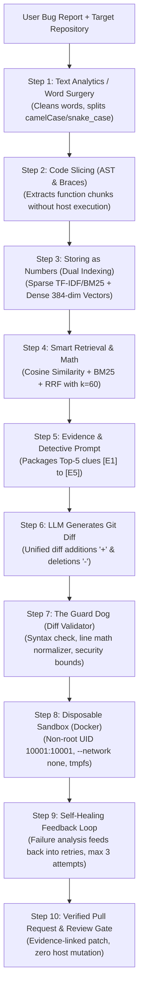

# DevMind — Complete Technical Architecture, 10-Step Pipeline, Concrete Examples & Viva Guide

---

## Part 1: The 10 Steps of DevMind (The Story of How It Works)



---

### Step 1: Taking the Input & Text Word Surgery (Text Analytics)

- **What happens:** The user provides two inputs:
  1. A natural language bug report (e.g., *"Batsman ball count increments by 2 instead of 1"*).
  2. A local repository folder path or public GitHub URL.
- **The Problem:** Humans speak casually; source code strictly uses identifiers like `matchState.balls`, `addRun`, or `calculate_total`.
- **What DevMind does (Text Analytics Pipeline):**
  - **NFKC Normalization:** Strips non-standard characters, normalizes curly quotes (`“ ”`), replaces typographic dashes, and removes invisible control characters.
  - **Compound Word Splitting:** Computers cannot bridge *"ball count"* to `ballCount` without morphological expansion. DevMind breaks `camelCase` $\rightarrow$ `['ball', 'Count']` and `snake_case` $\rightarrow$ `['ball', 'count']`.
  - **Stop-word Removal:** Discards conversational stop words (*"please"*, *"website"*, *"help"*), retaining information-dense domain keywords: `['batsman', 'ball', 'count', 'increment', '2']`.
  - **Category Tagging:** Rule-based heuristics flag whether the issue represents a *Logic Defect*, *Unhandled Exception*, *State Persistence Error*, or *Attribute Error*.

---

### Step 2: Code Slicing (Static Parsing Without Host Execution)

> [!CAUTION]
> **The Golden Safety Rule:** Never execute target repository code on the host machine during indexing. Untrusted code can harbor malicious scripts, environment leaks, or destructive system calls.

- **How DevMind extracts code units:**
  - **Python:** Uses Python’s standard `ast` (Abstract Syntax Tree) module. It reads code structurally to delineate class and function spans along with docstrings.
  - **JavaScript, TypeScript, HTML Inline Scripts, Go, C/C++:** Uses a deterministic Lexical Brace Tracker. It balances `{` and `}` delimiters to map functions, even inside embedded `<script>` blocks in HTML.
- **Metadata Attachment:** Every chunk receives traceable citation tags:
  ```json
  {
    "path": "script.js",
    "name": "addRun",
    "start_line": 437,
    "end_line": 492
  }
  ```

---

### Step 3: Storing Code as Numbers (Dual Indexing)

Computers operate on numerical representations. DevMind converts parsed code spans into vector spaces through two complementary indexing models:

1. **The Keyword Brain (Sparse TF-IDF & Okapi BM25):**
   - Measures term frequency and inverse document frequency.
   - Exact identifier tokens like `matchState.balls` or `safe_divide` receive high lexical scores.
2. **The Meaning Brain (Dense Vector Embeddings — `all-MiniLM-L6-v2`):**
   - A Sentence Transformers neural network encodes source intent into a 384-dimensional dense vector space.
   - Conceptual phrases like *"tallying score"* and *"counting deliveries"* map into close angular proximity even without shared vocabulary.

---

### Step 4: The Math of Finding the Culprit (Cosine Similarity & RRF)

How does DevMind pinpoint the buggy file?

#### 1. Cosine Similarity (Semantic Vector Proximity)
Calculates the cosine of the angle between the query vector $\mathbf{e}_q$ and the candidate code chunk vector $\mathbf{e}_d$:

$$\text{Cosine Similarity} = \frac{\mathbf{e}_q \cdot \mathbf{e}_d}{\|\mathbf{e}_q\| \|\mathbf{e}_d\|}$$

- **$\text{Angle} = 0^\circ$ ($\cos = 1.0$):** Identical semantic representation.
- **$\text{Angle} = 90^\circ$ ($\cos = 0.0$):** Orthogonal / unrelated context.

#### 2. Okapi BM25 (Sparse Lexical Retrieval)
Scores documents based on exact, rare token matches with saturation bounds.

#### 3. Reciprocal Rank Fusion (RRF, $k = 60$)
BM25 scores and Cosine similarities exist on different numerical scales. Directly adding them causes scale bias. RRF merges them strictly by ranked positions:

$$\text{RRF Score} = \frac{1}{60 + \text{Rank}_{\text{semantic}}} + \frac{1}{60 + \text{Rank}_{\text{keyword}}}$$

Chunks that rank consistently near the top across both keyword and semantic retrieval emerge as the **Top-5 Evidence Clues**: `[E1]`, `[E2]`, `[E3]`, `[E4]`, `[E5]`.

---

### Step 5: The Detective Prompt (Local LLM Integration)

DevMind avoids dumping entire repositories into the model's context window. It supplies only the Top-5 retrieved evidence chunks structured inside a constrained prompt template:

> *"You are an expert software engineer. Here is the bug report. Here are the exact code snippets [E1] to [E5]. Cite the clue you use, and output ONLY a valid Git Unified Diff to fix it. Do NOT output conversational prose or unformatted code blocks."*

---

### Step 6: Generating the Code Fix (Git Unified Diff)

The model emits standard unified diff formatting rather than full file rewrites:

```diff
diff --git a/script.js b/script.js
--- a/script.js
+++ b/script.js
@@ -450,3 +450,3 @@
- matchState.balls += 2;
+ matchState.balls += 1;
```

Lines starting with `-` denote removals; lines starting with `+` denote additions.

---

### Step 7: The Guard Dog (Deterministic Diff Validation)

Before any candidate patch enters testing, DevMind’s Python validation layer enforces three checks:

1. **Path Traversal Security:** Blocks patches attempting to write to directory traversal targets (`../../`), root paths, or outside the repository root.
2. **Structural Syntax Audit:** Validates unified diff headers (`diff --git`, `--- a/`, `+++ b/`, `@@`).
3. **Hunk Math Normalization (`_normalize_hunk_counts`):** Small LLMs frequently miscount line totals in `@@ -L,N +L,N @@`. DevMind recalculates the exact hunk counts so `git apply` executes without rejection.

---

### Step 8: The Disposable Test Sandbox (Docker Non-Root Isolation)

Candidate code is verified inside an isolated execution environment:

1. DevMind clones a disposable snapshot of the repository into memory / temporary storage. **The host repository is never modified.**
2. A lightweight Linux Docker container is created with strict sandbox constraints:
   - **Non-Root Execution:** Runs under unprivileged `UID:GID 10001:10001`.
   - **Network Disabled:** `--network none` blocks internet access, data exfiltration, and unauthorized package downloads.
   - **Ephemeral Storage:** Mounted as read-only or temporary in-memory `tmpfs`.
3. The real test runner executes inside the container (`pytest` for Python, `node --test` for JavaScript).

---

### Step 9: The Self-Healing Feedback Loop

- **If tests pass:** The run transitions to `tests_passed_review_required`.
- **If tests fail:** DevMind retains the trailing 4,000 characters of test output (stack traces, failure assertions) and feeds structured diagnostic context into a retry prompt:
  > *"Attempt 1 failed with this test error: AssertionError: expected 1 ball but got 0. Here is refined failure context. Try again."*
- **Bounded Attempts:** Limited to a maximum of 3 attempts to prevent infinite loops and token waste.

---

### Step 10: Reaching the User (The Final Deliverable)

DevMind provides:
1. **Visual Multi-Stage Workflow:** Live stepper tracking Analyzer $\rightarrow$ RAG Retrieval $\rightarrow$ Investigation $\rightarrow$ Patch $\rightarrow$ Sandbox $\rightarrow$ Review Gate.
2. **Cosine Similarity Chart:** Transparent bar chart displaying why specific functions were prioritized.
3. **Evidence-Linked Pull Request Draft:** Ready-to-use PR summary citing `[E1]` evidence and sandbox test proofs.
4. **Guaranteed Zero Host Mutation:** Pre- and post-run repository hashes verify that no unauthorized file modifications occurred.

---

## Part 2: The Three Concrete Examples

### 🏏 Example 1: The Cricket Scorer Bug (JavaScript / Web Frontend)

| Stage | What Happens in the System |
| :--- | :--- |
| **1. User Input** | **Bug Report:** *"In script.js addRun, change matchState.balls += 2; to matchState.balls += 1; so that each legal delivery adds one ball."*<br/>**Target Repo:** `examples/cricket-scorer-pro-buggy` |
| **2. Text Analytics** | • Cleans text via NFKC.<br/>• Extracts tokens: `['matchstate.balls', 'addrun', 'ball', 'delivery', 'legal']`.<br/>• Extracts component hints: `script.js`, `addRun`, `matchState.balls`.<br/>• Classifies issue as: *Logic Defect*. |
| **3. Code Indexing** | Lexical brace parser indexes `script.js`, extracting 54 functional chunks including `addRun`, `addExtra`, `confirmWicket`, and `formatOvers`. |
| **4. Retrieval Math** | • BM25 scores high on exact tokens `matchState.balls` in `script.js`.<br/>• Cosine Similarity matches query to `addRun` at `script.js:437–492` (similarity score `0.1952`).<br/>• RRF ranks `addRun` as Evidence **`[E1]`**. |
| **5. Model Call** | Prompt receives `[E1]` isolating lines 437–492 showing line 451: `matchState.balls += 2;`. |
| **6. Generated Diff** | Unified diff produced:<br/>`- matchState.balls += 2;`<br/>`+ matchState.balls += 1;` |
| **7. Validation** | Diff validator verifies `script.js` path, checks diff syntax, and recalculates hunk offsets. |
| **8. Docker Sandbox** | Disposable Node container executes: `node --test test/scoring.test.cjs`.<br/>**Result:** 1 test passed in 13.3ms, 0 failed. |
| **9. Result to User** | Streamlit UI displays green `tests_passed_review_required`. Exports Pull Request draft citing `[E1]`. |

---

### 🛒 Example 2: The QuickCart Bug (Python & JavaScript / State Persistence)

| Stage | What Happens in the System |
| :--- | :--- |
| **1. User Input** | **Bug Report:** *"Cart items disappear and total resets to 0 when browser is reloaded."*<br/>**Target Repo:** `examples/quickcart-cart-reload-buggy` |
| **2. Text Analytics** | • Splits compound terms: `['cart', 'items', 'disappear', 'total', 'reset', 'browser', 'reload']`.<br/>• Identifies component hints: `localStorage`, `cart`.<br/>• Classifies as: *State Persistence Defect*. |
| **3. Code Indexing** | AST indexes Python backend routes while lexical brace tracker indexes client-side `index.html` inline `<script>` blocks. |
| **4. Retrieval Math** | • BM25 matches `cart` and storage access keys.<br/>• Dense Cosine aligns the concept of *"reloading page loses data"* with page initialization logic.<br/>• RRF selects `restoreCartFromStorage()` as Evidence **`[E1]`**. |
| **5. Model Call** | Prompt reveals that the initialization sequence omits reading `localStorage.getItem("quickcart_items")` upon startup. |
| **6. Generated Diff** | Model generates patch inserting storage restoration logic into the startup handler. |
| **7. Validation** | Confirms target path safety, proper indentation, and hunk integrity. |
| **8. Docker Sandbox** | Sandbox applies diff in memory and runs `node --test test/cart-reload.test.cjs`.<br/>**Result:** Baseline failed; candidate patch passes 1/1 tests. |
| **9. Result to User** | Status marked `tests_passed_review_required`. Generates verified report without host modification. |

---

### ➗ Example 3: The Calculator Bug (Python / Core Math & Exceptions)

| Stage | What Happens in the System |
| :--- | :--- |
| **1. User Input** | **Bug Report:** *"safe_divide crashes when denominator is zero; it should return None as documented and expected by the tests."*<br/>**Target Repo:** `examples/buggy_project` |
| **2. Text Analytics** | • Extracts tokens: `['safe_divide', 'crashes', 'denominator', 'zero', 'none']`.<br/>• Classifies as: *Unhandled Exception / ZeroDivisionError*. |
| **3. Code Indexing** | Python AST (`ast.parse`) indexes `calc.py`, isolating `safe_divide(a, b)`. |
| **4. Retrieval Math** | • BM25 identifies token `safe_divide`.<br/>• Dense embeddings match *"division by zero crash"* directly to `safe_divide` (high cosine similarity).<br/>• RRF ranks `calc.py:safe_divide` as Evidence **`[E1]`**. |
| **5. Model Call** | Model inspects `safe_divide` source showing unguarded `return a / b`. |
| **6. Generated Diff** | Emits patch adding guard condition:<br/>`+ if b == 0:`<br/>`+ return None`<br/>` return a / b` |
| **7. Validation** | Validates line offsets and confirms no unexpected global imports were added. |
| **8. Docker Sandbox** | Disposable Python container executes `pytest -q`.<br/>**Result:** 2/2 tests passed in 0.4s. |
| **9. Result to User** | Displays test logs, updates dashboard statistics (+1 verified repair), and provides verified diff. |

---

## Part 3: Viva & Presentation Script (What to Say to Your Professor)

> *"Ma'am, DevMind is an evidence-grounded software bug localization and repair system designed to bridge the semantic gap between natural-language bug descriptions and repository source code.
>
> When a user submits an unstructured bug report, our pipeline begins with **Text Analytics**: applying NFKC normalization, compound word splitting across camelCase and snake_case tokens, stop-word removal, and rule-based defect classification.
>
> Next, our static indexing engine parses source files across 11+ programming languages using Python AST and lexical brace tracking **without executing any target code on the host machine**.
>
> To localize the defect, DevMind uses a **two-stage hybrid retrieval architecture**: combining sparse lexical retrieval (TF-IDF and BM25) with dense 384-dimensional semantic embeddings (`all-MiniLM-L6-v2`) merged via **Reciprocal Rank Fusion ($k = 60$)**. In our empirical evaluation on SWE-bench Lite instances, TF-IDF achieved **0.800 Recall@5** and constructed indexes **496 times faster** than dense vector models, because code localization relies heavily on exact identifier matches.
>
> Finally, our local model generates a targeted Git unified diff, verified by our deterministic syntax and security validator, and tested inside an **isolated non-root Docker container (`UID 10001:10001`)** with `--network none` and ephemeral storage. If tests fail, a self-healing diagnostic loop refines the prompt across up to three attempts.
>
> Crucially, DevMind enforces **zero host mutation**—candidate patches are validated in disposable containers and surfaced under a human review gate with an evidence-grounded Pull Request draft. Our entire implementation is verified by **180 automated unit tests**."*
