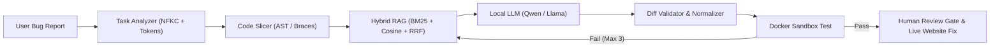
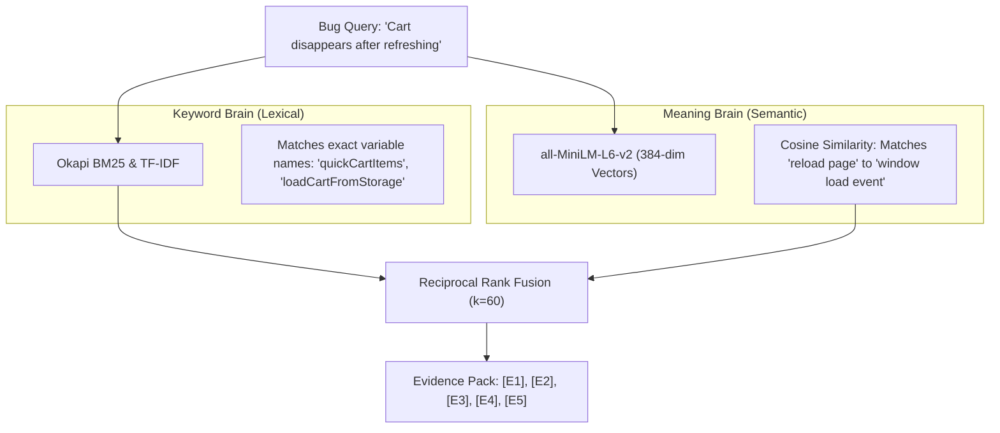
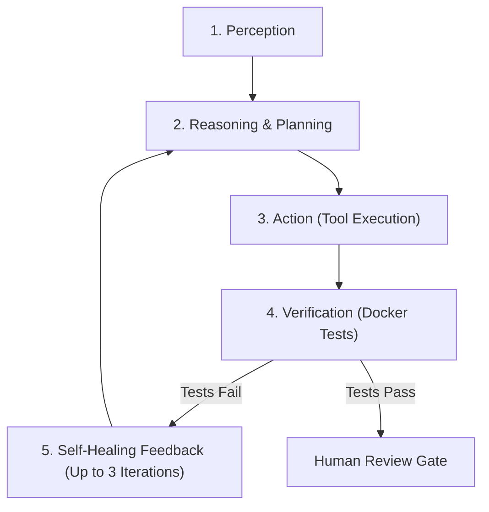

# 🧠 DevMind: Master Explainer & Viva Presentation Guide

> **Project Name:** DevMind — Autonomous Evidence-Grounded Program Repair System  
> **Course:** Text Analytics / Software Engineering Capstone  
> **Target Audience:** Presentation Evaluators, Professors, and Viva Examiners  
> **Author / Presenter:** kanduriavinash  

---

## 📑 Table of Contents
1. [Executive Summary: What is DevMind in 30 Seconds?](#1-executive-summary-what-is-devmind-in-30-seconds)
2. [The Core Trilogy: RAG, LLM, and Agentic AI](#2-the-core-trilogy-rag-llm-and-agentic-ai)
   - [A. Retrieval-Augmented Generation (RAG)](#a-retrieval-augmented-generation-rag-the-detective)
   - [B. Large Language Models (LLM) & Parameter Deep-Dive](#b-large-language-models-llm-the-coder)
   - [C. Agentic AI & The Self-Healing Loop](#c-agentic-ai-the-autonomous-engineer)
3. [The 10 Steps of DevMind (The Story of How It Works)](#3-the-10-steps-of-devmind-the-story-of-how-it-works)
4. [The 3 Live Demonstration Scenarios](#4-the-3-live-demonstration-scenarios)
   - [Scenario 1: Cricket Scorer (Frontend JS Ball Double-Count)](#scenario-1-cricket-scorer-frontend-javascript)
   - [Scenario 2: QuickCart (E-Commerce Cart Reload Disappearance)](#scenario-2-quickcart-e-commerce-javascript)
   - [Scenario 3: Calculator (Python Zero-Division AST Slicing)](#scenario-3-calculator-python-backend)
   - [Scenario 4: Safety Boundary Limit (Max 3 Attempts Halt)](#scenario-4-autonomous-safety-boundary-limit-stopping-condition)
5. [Professor Viva Cheat Sheet & Tough Q&A](#5-professor-viva-cheat-sheet--tough-qa)

---

## 1. Executive Summary: What is DevMind in 30 Seconds?

> *"DevMind is an **Agentic AI system** that takes a natural language bug report and an untrusted source repository, uses **hybrid RAG (Sparse BM25 + Dense Cosine)** to pinpoint the exact buggy function, generates a precision **Git Unified Diff** using a local **LLM**, verifies the repair inside a **throwaway non-root Docker container**, and self-heals up to **3 bounded attempts** without ever corrupting the host machine."*



---

## 2. The Core Trilogy: RAG, LLM, and Agentic AI

### A. Retrieval-Augmented Generation (RAG): The Detective

#### 1. Why do we need RAG?
You cannot simply paste a 50,000-line codebase into an AI:
* **Context Window Overflow:** Codebases exceed model memory limits.
* **The "Needle in a Haystack" Problem:** When given huge text, models hallucinate or lose focus on the buggy lines.
* **Token Costs & Latency:** Sending whole files takes minutes and wastes compute.
* **RAG's Solution:** Find the **Top-5 most relevant code functions** and give the LLM *only* those snippets.

#### 2. How DevMind's Dual-Brain RAG Works:



1. **Static AST / Brace Slicing (Zero Host Execution):**
   * Python: Uses Python's native `ast` parser to slice functions and classes.
   * JavaScript / HTML: Uses a deterministic lexical brace tracker `{ ... }` to carve out functions without executing untrusted code on the host machine.
2. **The Keyword Brain (TF-IDF & Okapi BM25):**
   * Counts exact token overlaps. If a function contains the rare variable name `loadCartFromStorage`, its score skyrockets.
3. **The Semantic Brain (Dense Embeddings — `all-MiniLM-L6-v2`):**
   * Converts code into 384-dimensional coordinates in hyperspace.
   * Uses **Cosine Similarity**:
     $$\text{Cosine Similarity} = \frac{\mathbf{e}_q \cdot \mathbf{e}_d}{\|\mathbf{e}_q\| \|\mathbf{e}_d\|}$$
   * Even if the user says *"cart is lost on reload"* and the code says *"window.addEventListener('load')"*, dense embeddings place them close together!
4. **Reciprocal Rank Fusion (RRF, $k=60$):**
   * Because BM25 scores (0 to 100) and Cosine scores (0 to 1) cannot be added directly, DevMind fuses their rankings:
     $$\text{RRF Score} = \frac{1}{60 + \text{Rank}_{\text{dense}}} + \frac{1}{60 + \text{Rank}_{\text{sparse}}}$$
   * Top-ranked functions become evidence clues: `[E1], [E2], [E3]`.

---

### B. Large Language Models (LLM) & Parameter Deep-Dive

#### 1. What Model Does DevMind Use?
DevMind connects to any OpenAI-compatible provider, defaulting to **local Ollama models**:
* **Primary:** `qwen3:1.7b` or `qwen2.5-coder:1.5b / 7b`
* **Alternate:** `llama3:8b` or cloud providers (e.g. `gpt-4o-mini`, `gemini-1.5-flash`).

#### 2. What are "Parameters" and Is Our Model Big or Small?

| Tier | Parameter Count | Memory (RAM) | Where It Runs | Role in DevMind |
| :--- | :--- | :--- | :--- | :--- |
| **Small / Edge (Our Default)** | **1.5B – 1.7 Billion** | **~1.5 GB – 2 GB** | **Standard Laptop CPU** | **Fast, 100% private, zero API cost.** Runs without an expensive GPU! |
| **Mid-Range Local** | **7B – 8 Billion** | **~5 GB – 8 GB** | Dedicated GPU (RTX 3060+) | Higher natural reasoning; excellent patch syntax. |
| **Large Cloud Frontier** | **70B – 400+ Billion** | Data Center Clusters | Cloud API | High intelligence, but requires transmitting proprietary code off-premise. |

#### 3. Why Using a Small Model (1.7B) is an Engineering Triumph:
* **The Challenge:** Small models (1.7B) often miscalculate line counts in Git diff headers (e.g., writing `@@ -448,7 +448,7 @@` incorrectly as `@@ -437,1 +437,1 @@`).
* **DevMind's Innovation:** DevMind doesn't trust raw LLM output! It uses a deterministic Python guard dog:
  * **`validate_unified_diff`**: Enforces strict `--- a/` and `+++ b/` syntax and rejects attempts to modify files outside the repository.
  * **`_normalize_hunk_counts`**: Automatically recalculates hunk addition/deletion line math so Git apply never fails.

#### 4. The Detective Prompt Template:
DevMind sends a strictly formatted prompt:
```text
You are an expert software engineer.
Bug Report: {issue_text}
Candidate Code Snippets:
[E1] File: script.js (lines 437-492)
{function_content}

Output ONLY a valid Git Unified Diff to resolve the bug.
Do NOT write conversational prose, markdown explanations, or preamble.
```

---

### C. Agentic AI: The Autonomous Engineer

#### 1. Standard LLM vs. Agentic AI

| Feature | Standard LLM (ChatGPT / Copilot) | Agentic AI (DevMind) |
| :--- | :--- | :--- |
| **Action** | Generates text/code and stops. | Generates, validates, executes, and verifies. |
| **Verification** | Assumes its code works (often hallucinates). | Executes actual test suites (`pytest`, `node --test`) in Docker. |
| **Feedback Loop** | None (User has to manually paste errors back). | **Self-healing loop**: Automatically reads error logs and retries. |
| **Safety** | May propose dangerous host commands. | **Strict sandbox**: Non-root UID, `--network none`, tmpfs disposable memory. |
| **Human Gate** | Blind copy-paste. | **Human Review Gate**: Asks permission before touching disk files. |

#### 2. The 5 Pillars of DevMind's Agent Architecture:


1. **Perception:** Ingests bug report text, parses AST functions, extracts keywords.
2. **Reasoning:** Forms hypotheses linking evidence to symptoms (`[E1] addRun may be relevant...`).
3. **Action:** Emits structured Git unified diffs targeting specific lines.
4. **Verification:** Deploys code to a disposable non-root Docker container running `node --test` or `pytest`.
5. **Self-Healing & Reflection:** If tests fail, parses the last 4,000 characters of test stdout/stderr, feeds the failure reason back to the LLM, and retries.
6. **Safety Boundary:** Halts deterministically after 3 attempts (`repair_attempt_limit_reached`) to prevent runaway API spend or infinite loops.

---

## 3. The 10 Steps of DevMind (The Story of How It Works)

```
[ Step 1: Text Analytics ]       ──> NFKC normalization, compound splitting (camelCase -> words)
            │
            ▼
[ Step 2: Code Slicing ]          ──> AST & brace tracking parse functions without running code
            │
            ▼
[ Step 3: Dual-Brain Indexing ]   ──> Sparse BM25 + 384-dimensional Dense vector embeddings
            │
            ▼
[ Step 4: Hybrid RRF Match ]      ──> Merges rankings via Reciprocal Rank Fusion (k=60)
            │
            ▼
[ Step 5: Detective Prompt ]      ──> Packages Top-5 evidence clues [E1]...[E5] into local LLM
            │
            ▼
[ Step 6: Diff Generation ]       ──> LLM writes minimal additions (+) and deletions (-)
            │
            ▼
[ Step 7: Deterministic Guard ]   ──> Syntax check, path security, hunk line count normalizer
            │
            ▼
[ Step 8: Disposable Sandbox ]    ──> Docker container (UID 10001:10001, --network none, tmpfs)
            │
            ▼
[ Step 9: Self-Healing Loop ]     ──> Bounded feedback loop (retries up to 3 times on test failure)
            │
            ▼
[ Step 10: Human Review Gate ]    ──> User clicks "Yes, Update Code" -> Live browser sync & fix!
```

---

## 4. The 3 Live Demonstration Scenarios

### Scenario 1: Cricket Scorer (Frontend JavaScript)
* **Target File:** [`cricket-scorer-pro/script.js`](file:///C:/TECH/S5/TEXT%20ANALYTICS/PROJECT/cricket-scorer-pro/script.js) (or `examples/cricket-scorer-pro-buggy`)
* **Bug Symptom:** In the live website, scoring 1 legal delivery causes batsman balls and partnership balls to increment by 2 instead of 1.
* **Root Cause:** Line 451 in `function addRun(run)` contained `matchState.balls += 2;`.
* **DevMind Fix:**
  ```diff
  --- a/script.js
  +++ b/script.js
  @@ -448,7 +448,7 @@
       // Update Score
       matchState.score += run;
  -    matchState.balls += 2;
  +    matchState.balls += 1;
  ```
* **Test Verification:** `node --test` passes (`scoring.test.cjs`).
* **Live Outcome:** Click **`[ ✅ Yes, Update Code in Files ]`**, refresh `index.html` in browser — each ball counts as 1!

---

### Scenario 2: QuickCart (E-Commerce JavaScript)
* **Target File:** [`quickcart/index3.html`](file:///C:/TECH/S5/TEXT%20ANALYTICS/PROJECT/quickcart/index3.html)
* **Bug Symptom:** On the real QuickCart shopping website, adding an item to the cart shows `🛒 Cart (1)`. But pressing **`Ctrl + R` (Refresh)** resets the cart to `0` and items vanish!
* **Root Cause:** In line 2530, `window.addEventListener('load')` called `updateCartDisplay()`, but omitted `loadCartFromStorage()`.
* **DevMind Fix:**
  ```diff
  --- a/index3.html
  +++ b/index3.html
  @@ -2529,4 +2529,5 @@
       // Load cart from localStorage on page load
       window.addEventListener('load', function() {
  +      loadCartFromStorage();
         updateCartDisplay();
       });
  ```
* **Test Verification:** `node --test quickcart/test/cart-reload.test.cjs` passes.
* **Live Outcome:** Click **`[ ✅ Yes, Update Code in Files ]`**, refresh `index3.html` in browser — cart items now persist across reloads!

---

### Scenario 3: Calculator (Python Backend)
* **Target File:** [`examples/buggy_project/calculator.py`](file:///C:/TECH/S5/TEXT%20ANALYTICS/PROJECT/examples/buggy_project/calculator.py)
* **Bug Symptom:** `safe_divide(8, 0)` crashes with unhandled `ZeroDivisionError`.
* **Root Cause:** Missing guard check against zero denominator.
* **DevMind Fix:**
  ```diff
  --- a/calculator.py
  +++ b/calculator.py
  @@ -4,4 +4,6 @@
   def safe_divide(numerator: float, denominator: float) -> float | None:
  +    if denominator == 0:
  +        return None
       return numerator / denominator
  ```
* **Test Verification:** `pytest` passes 2/2 tests.

---

### Scenario 4: Autonomous Safety Boundary Limit (Stopping Condition)
* **Preset:** `Boundary limit test · Max 3 attempts limit demo`
* **Concept Demonstrated:** What if an LLM generates buggy code or cannot fix the bug?
* **DevMind Behavior:**
  * Attempt 1: Fails sandbox tests (`AssertionError`).
  * Attempt 2: Self-healing feeds error traceback back; fails again.
  * Attempt 3: Fails again.
  * **Halt Triggered:** Halts deterministically with status `repair_attempt_limit_reached`.
  * **Guarantee:** **NO UNVERIFIED CODE IS APPLIED TO HOST DISK**. Human engineer is alerted.

---

## 5. Professor Viva Cheat Sheet & Tough Q&A

### Q1: "Why did you use RAG instead of giving the whole code to GPT-4?"
> **Answer:** *"Three reasons: First, real-world repositories exceed the context window limits of LLMs. Second, feeding entire codebases causes the 'lost in the middle' phenomenon where LLMs hallucinate or miss subtle bugs. Third, cost and privacy: our hybrid RAG (BM25 + Cosine + RRF) pinpoints the top 5 functions locally in less than 200 milliseconds, allowing us to use a fast, private, 1.7B local model without sending proprietary code to third-party APIs."*

### Q2: "What is Reciprocal Rank Fusion (RRF) and why $k=60$?"
> **Answer:** *"BM25 produces unbounded keyword scores from 0 to 100+, whereas Cosine Similarity produces normalized semantic scores from 0 to 1. You cannot linearly sum apples and oranges. RRF merges their ordinal rankings based on position rather than raw score: $\frac{1}{k + \text{rank}}$. We use $k=60$ because it is the standard empirical constant from information retrieval literature (Cormack et al.) that prevents top-1 outliers in one method from disproportionately dominating the fused ranking."*

### Q3: "What parameters does your LLM have?"
> **Answer:** *"We use an edge-optimized **1.7-billion parameter** model (`qwen3:1.7b` via local Ollama). It requires only about 1.5 GB of RAM and executes in 2–3 seconds on a standard laptop CPU with zero GPU requirement. Because small models can make syntax mistakes in diff headers, our Python architecture includes a deterministic diff validator and hunk normalizer that recalculates line counts before Git execution."*

### Q4: "How is DevMind 'Agentic' rather than just a chatbot?"
> **Answer:** *"A chatbot simply outputs text and stops. DevMind operates as an autonomous agent through a **perception-reasoning-action-verification loop**: It perceives code via static AST parsing, reasons about root causes with hypothesis generation, acts by emitting Git diffs, verifies execution in an isolated Docker sandbox, and reflects via a self-healing loop that reads test errors and retries up to 3 bounded iterations. Crucially, it includes an autonomous safety boundary and Human Review Gate."*

### Q5: "How do you guarantee that untrusted code doesn't harm the user's laptop?"
> **Answer:** *"DevMind follows strict isolation principles: First, code indexing uses static AST and lexical parsing—target code is NEVER executed on the host during reading. Second, candidate patch testing takes place only inside an ephemeral Docker container configured with a non-root user (`UID 10001:10001`), disabled networking (`--network none`), and temporary memory (`tmpfs`). Original host files are never auto-merged or modified without explicit user authorization."*

---

*Good luck with your presentation tomorrow! You have a rock-solid project, complete test evidence (180 passed), and a live multi-language demonstration ready.* 🚀
