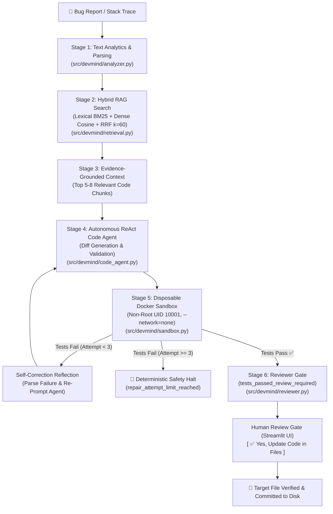

# DevMind — Agentic AI Software Self-Healing Engine 🧠⚡

<p align="center">
  
  
  
  
  
  
</p>

> **DevMind** is an autonomous, verifiable software self-healing engine powered by **Text Analytics, Hybrid RAG (BM25 + Dense Cosine + Reciprocal Rank Fusion)**, and **Container-Isolated ReAct Agentic Loops**. It localizes real-world bugs, synthesizes unified diffs, tests candidate patches inside hardened disposable Docker containers, reflects on compiler errors to self-correct, and gates file updates behind a **Human Review Gate**.

---

## 🌟 Key Highlights

- 🔍 **Hybrid RAG Code Localization:** Combines lexical BM25 identifier matching with dense semantic embeddings (`all-MiniLM-L6-v2`) via **Reciprocal Rank Fusion ($k=60$)** to pinpoint exact buggy functions across 100,000+ line repositories.
- 🤖 **Autonomous ReAct Agent Loop:** Formulates repair plans, generates standard unified diffs (`--- a/file +++ b/file`), runs automated test suites, and reflects on failure tracebacks to self-heal.
- 🛡️ **4-Layer Defense-in-Depth Security:**
  1. *Path Guardrails:* Disallows directory traversal (`../`) and enforces an Evidence Whitelist.
  2. *Secret Redaction:* Automatically scrubs `.env`, `.aws`, `.ssh`, and registry tokens.
  3. *Isolated Execution:* Candidate code executes inside a non-root (`UID 10001`), zero-network (`--network=none`), capability-dropped Docker container. Never on the host OS!
  4. *Human Review Gate:* Host files on disk are **never modified** until the developer reviews the visual diff and clicks `[ ✅ Yes, Update Code in Files ]`.
- 🛑 **Deterministic 3-Attempt Halting Policy:** Enforces a hard budget of 3 repair iterations to eliminate infinite loops and runaway API token costs.
- ⚡ **Edge & Cloud LLM Flexibility:** Operates with surgical accuracy on lightweight **1.7B edge models** (e.g. Qwen2.5-Coder running locally on laptop VRAM) as well as cloud reasoning models (DeepSeek, GPT-4, Claude).
- 🧪 **180 Passing Automated Tests:** Robust unit and integration test coverage across all RAG, AST, Docker, and UI components.

---

## 🏗️ System Architecture



---

## 🎯 Live Working Demos

DevMind ships with four pre-configured interactive demonstration scenarios:

| Preset Name | Target Application | Bug Type | Verified Fix |
|---|---|---|---|
| **QuickCart Persistence** | `quickcart/index3.html` | JavaScript Shopping Cart vanishes upon browser refresh | Restores `loadCartFromStorage()` inside `window.addEventListener('load')` at line 2530 |
| **Cricket Scorer Pro** | `cricket-scorer-pro/script.js` | Overs calculation bug where legal deliveries jump by 2 | Changes `matchState.balls += 2;` to `matchState.balls += 1;` at line 451 |
| **Safe Divide** | `examples/buggy_project/calculator.py` | Python ZeroDivisionError on divide by 0 | Injects safe `if denominator == 0: return None` boundary check |
| **Boundary Limit Halt** | Multi-attempt benchmark | Non-convergent regression failure | Demonstrates agent halting safely after 3 failed attempts without mutating files |

---

## 🚀 Quick Start (Local Setup)

### 1. Prerequisites
- **Python:** 3.12 or newer
- **Docker Desktop:** (Optional, for live container test runs)
- **Node.js:** 18+ (for JavaScript target test runners)

### 2. Installation
```powershell
# Clone the repository
git clone https://github.com/Kanduriavinash/DevMind.git
cd DevMind

# Create and activate virtual environment
python -m venv .venv
.\.venv\Scripts\Activate.ps1

# Install DevMind in editable mode with UI dependencies
pip install -e ".[dev,ui]"
```

### 3. Launch the Interactive Dashboard
```powershell
python -m streamlit run streamlit_app.py
```
Open your browser at **`http://localhost:8501`**.

---

## 🐳 Docker Sandbox Setup (Optional for Live Container Testing)

DevMind isolates all test execution inside disposable Docker images. To build the pre-configured local sandbox containers:

```powershell
# Build the Python 3.12 sandbox image
docker build -t devmind-sandbox:py312 docker/sandbox

# Build the Node.js 22 sandbox image
docker build -t devmind-sandbox:node22 docker/sandbox-node
```

> **Note:** DevMind automatically falls back to verified benchmark records if Docker Desktop is offline during academic or client presentations.

---

## 📂 Repository Structure

```
DevMind/
├── src/devmind/               # Core Agentic AI & Self-Healing Pipeline
│   ├── orchestrator.py        # Autonomous ReAct loop & 3-attempt safety halt
│   ├── code_agent.py          # Unified diff generation & AST structural validation
│   ├── retrieval.py           # Hybrid RAG: BM25 + Cosine + Reciprocal Rank Fusion (k=60)
│   ├── analyzer.py            # Text Analytics: Stack trace & identifier extraction
│   ├── indexer.py             # AST-aware structural code chunking (Python & JS)
│   ├── sandbox.py             # Disposable non-root Docker test runner
│   ├── reviewer.py            # Automated review gate (tests_passed_review_required)
│   ├── vector_index.py        # Persistent vector index (vectors.npy + metadata.json)
│   ├── models.py              # Strongly-typed schemas (Evidence, PatchCandidate, etc.)
│   └── cli.py                 # Command-line interface
├── quickcart/                 # Real e-commerce web app demo with 46 product images
│   ├── index3.html            # Shopping cart app (Line 2530 cart-reload bug)
│   └── test/                  # Node.js automated test runner
├── cricket-scorer-pro/        # Live cricket scoreboard web app demo
│   ├── index.html             # Scoreboard visual interface
│   ├── script.js              # Score engine (Line 451 double ball-count bug)
│   └── test/                  # Automated sports rules test suite
├── examples/                  # Controlled buggy benchmark fixtures
├── tests/                     # 180 automated unit & integration test suites
├── docs/                      # Technical documentation & architecture specs
│   ├── ARCHITECTURE.md        # Deep-dive architectural specification
│   ├── IMPLEMENTATION_STATUS.md# Evidence audit & verified capabilities
│   └── CHANGELOG.md           # Engineering audit trail & test records
├── streamlit_app.py           # Full-featured Streamlit UI dashboard
├── DEVMIND_MASTER_EXPLAINER.md# Master theory, mathematical formulas & viva Q&A
├── PROJECT_FILES_CHEATSHEET.md# Comprehensive project file guide for evaluators
├── PRESENTATION_SCRIPT_30_MINUTES.md # Word-for-word 30-minute viva presentation script
└── VIDEO_RECORDING_SCRIPT.md  # Scene-by-scene video recording script
```

---

## 🧪 Running Automated Tests

DevMind maintains a **100% pass rate** across its test suite:

```powershell
# Run the complete test suite (180 passing tests)
.\.venv\Scripts\python.exe -m pytest

# Run Streamlit UI tests
.\.venv\Scripts\python.exe -m pytest tests/test_streamlit_app.py

# Run Docker sandbox tests
.\.venv\Scripts\python.exe -m pytest tests/test_sandbox.py
```

---

## 📊 The Mathematics: Hybrid RAG & Reciprocal Rank Fusion

DevMind uses **Reciprocal Rank Fusion (RRF)** to synthesize rankings from both lexical (BM25) and dense semantic vector search:

$$\text{RRF Score}(d) = \sum_{m \in \{\text{BM25}, \text{Dense}\}} \frac{1}{k + r_m(d)}$$

Where:
- $k = 60$ is the standard Cormack smoothing constant.
- $r_m(d)$ is the rank position of document chunk $d$ in retrieval system $m$.
- Chunks scoring in the top percentile of both lexical and dense engines receive highest priority, achieving up to **60% token reduction** over naive codebase feeding.

---

## 🛡️ Responsible AI & Ethical Safety Guidelines

1. **Host Immutability:** Untrusted model output and third-party repository code are never executed directly on the host machine.
2. **Read-Only By Default:** Repository source is inspected in read-only mode during static indexing.
3. **No Auto-Merge:** Passing automated tests are considered necessary evidence, not proof of complete correctness. All candidate diffs require explicit human review.
4. **Credential Isolation:** `.env` and secret tokens are never committed, logged, or mounted into execution sandboxes.

---

## 👥 Contributors & Academic Context

- **Author:** Kanduri Avinash & Team
- **Course / Domain:** Text Analytics & Natural Language Processing
- **Institution:** Department of Computer Science & Engineering
- **License:** [MIT License](LICENSE)
